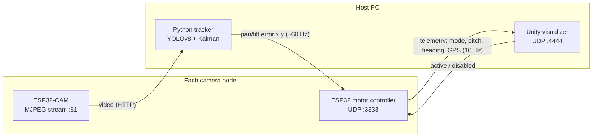

# Distributed Camera Node Tracking System

A distributed, multi-node camera system that follows and triangulates the 3D position of a moving target (for example a drone!) in real time. 
Instead of relying on a single crazy expensive sensor, it combines low-cost nodes to get things no single camera can provide, such as spatial triangulation and wide-area coverage.

<video controls width="100%" src="https://github.com/user-attachments/assets/d666da68-4de4-413b-ad2b-b3b17028fe75"></video>

## But... what's in a node??

Each physical node has:

- An ESP32-CAM that streams live MJPEG video over Wi-Fi
- A secondary ESP32 motor controller that pans and tilts the camera with two stepper motors, driven by a PD control loop (scary math ooooh)
- An MPU6050 IMU and a QMC5883L magnetometer for pitch and heading
- A GPS module to geo-locate itself

## How do the pieces talk?

First let me show you the architecture:

1. The Python tracker pulls the video stream from every node, runs a custom-trained YOLOv8 model and smooths detections with a Kalman filter (scary math part 2)
2. It sends a normalised pan/tilt error back to each motor controller, which turns it into stepper motor motion
3. Each motor controller reports its orientation and GPS position to the Unity visualizer, which triangulates the target's 3D position with least squares and shows it on a geo-referenced grid
4. From Unity you can switch each node between active and disabled. Nodes boot disabled

## Let's get started shall we?

- :material-wrench: [Hardware](getting-started/hardware.md): parts list, 3D-printed mount, wiring
- :material-chip: [Firmware](getting-started/firmware.md): flash the ESP32 boards
- :material-language-python: [Python tracker](getting-started/python-tracker.md): configure and run detection
- :material-unity: [Unity visualizer](getting-started/unity-visualizer.md): set up the 3D view and triangulation
- :material-cog: [How it works](how-it-works.md): Kalman filter, PD control, triangulation, that kind of stuff
- :material-lan: [Network protocol](reference/network-protocol.md): every UDP message and port

## The repository layout

| Path | Contents |
|---|---|
|Firmware/ID0.cpp, Firmware/ID1.cpp | ESP32 motor-controller firmware for node 0 and node 1 |
|Software/Python/Config.py | Tracker configuration (IPs, ports, model path, tuning) |
|Software/Python/YOLOProcessing.py | Main Python tracking script |
|Software/Unity/ | Unity C# scripts for visualisation and triangulation |
|Software/people-model.pt | YOLOv8 model that tracks people |
|Hardware/Cad/CameraNode.f3d | Fusion 360 source for the pan/tilt mount |
|Hardware/STL/ | STL parts you can 3D print |
|Media/Demo Video/ | One-minute demo video |
|Media/Prototypes/ | Photos and clips of the thing |
|docs/ | You are here |

---

Original project by — Alisher Khojayev  
Edit and docs by — Mekhy W.
